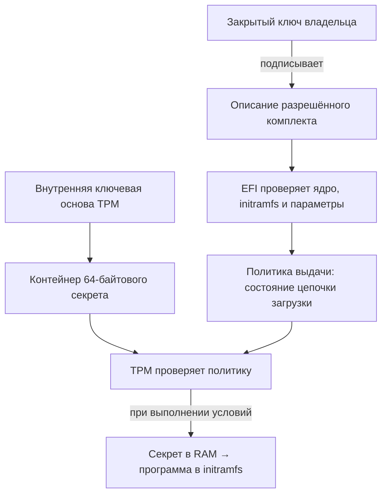

# TPMBOOT — автоматическая выдача секрета при доверенной загрузке

## Назначение

Проект обеспечивает автоматическую передачу 64-байтового секрета программе раннего запуска Linux. Секрет выдаётся TPM только для заранее зарегистрированной конфигурации загрузки и передаётся получателю через оперативную память.

Целевые сценарии защиты: копирование EFI-раздела на другой компьютер и подмена загрузочных компонентов. Ввод пароля пользователем при загрузке не требуется.

**Платформа:** x86-64, UEFI, TPM 2.0. Текущая демонстрация использует Debian в VMware; Secure Boot выключен.

## Ключевая схема

В проекте разделены подпись доверенного программного комплекта и защита прикладного секрета.

| Элемент | Назначение | Размещение |
|---|---|---|
| Закрытый ключ подписи Ed25519 | Подтверждает, какой загрузочный комплект разрешён владельцем системы | В доверенной среде подготовки |
| Публичный ключ подписи | Позволяет EFI-загрузчику проверить подпись комплекта | Встроен в EFI-загрузчик |
| Прикладной секрет — 64 байта | Передаётся программе-получателю при каждой разрешённой загрузке | При использовании — в оперативной памяти |
| Защищённый TPM-контейнер | Содержит запечатанный секрет и связанную с ним политику выдачи | Файл на EFI-разделе |
| Внутренняя ключевая основа TPM | Привязывает контейнер к конкретному TPM | Защищается самим TPM |

На EFI-разделе хранится защищённый контейнер. Исходный секрет и закрытый ключ подписи не должны храниться там в открытом виде. Копия контейнера сама по себе не позволяет получить исходный секрет на независимом TPM.

Подпись охватывает хеши ядра и initramfs, а также параметры запуска. Это связывает разрешение на загрузку с конкретным программным комплектом.

## Связь с доверенной цепочкой

Прошивка и загрузчик фиксируют измерения загрузочных компонентов в регистрах TPM — **PCR**. Эти регистры отражают накопленное состояние цепочки загрузки.

При регистрации секрет связывается со снимком выбранных PCR в определённой точке ранней загрузки. При последующих стартах TPM разрешает выдачу только при совпадении условий. Подмена загрузчика или изменение разрешённого комплекта должны приводить к отказу в получении исходного секрета.

Программа-получатель включена в подписанный initramfs. Поэтому проверяется целостность всего раннего окружения, содержащего получателя. После выдачи секрета загрузчик изменяет контрольное состояние TPM и закрывает возможность повторной выдачи по той же ранней политике в рамках текущего запуска.

При выключенном Secure Boot защита зависит от корректного измерения загрузки доверенной прошивкой. Сам запуск постороннего кода не запрещается; получение исходного секрета ограничивает политика TPM.

## Основные этапы

### 1. Подготовка

Формируется комплект из EFI-загрузчика, ядра Linux, initramfs с программами регистрации и получения секрета, а также подписанного описания комплекта. Устанавливается загрузчик и явно разрешается первоначальная регистрация.

### 2. Первая перезагрузка — регистрация

Новый EFI-загрузчик проверяет комплект и получает фактический снимок раннего состояния TPM. Снимок передаётся доверенной программе в initramfs.

Программа запечатывает 64-байтовый секрет средствами TPM с привязкой к этому состоянию и сохраняет контейнер на EFI-разделе. Использование фактического снимка исключает необходимость заранее предсказывать состояние новой цепочки загрузки.

### 3. Вторая перезагрузка — получение

Тот же EFI-загрузчик повторно проверяет комплект. TPM проверяет зарегистрированные условия и выдаёт секрет. Загрузчик передаёт его программе в initramfs через оперативную память.

Программа использует секрет по назначению. В демонстрации она сверяет длину и контрольную сумму, затем удаляет файл передачи.

### 4. Продолжение загрузки ОС

После успешной проверки демонстрация показывает результат, выдерживает паузу 30 секунд и передаёт управление установленному Debian. Последующие загрузки проходят без повторной регистрации и без участия пользователя.

## Демонстрация и текущий статус

Для наглядного сравнения предусмотрен вывод случайного тестового секрета в шестнадцатеричном виде перед запечатыванием и после получения. Такой вывод предназначен только для демонстрации: он раскрывает секрет наблюдателю консоли.

| Проверка | Статус |
|---|---|
| Регистрация секрета на vTPM VMware | Подтверждена на стенде |
| Получение тех же 64 байт программой в initramfs | Подтверждено на стенде |
| Повторная загрузка и полное выключение/включение VM | Подтверждены на стенде |
| Сборка обновлённого демонстрационного релиза и программные тесты | Выполнены |
| Полный сценарий обновлённого релиза: hex → успешная проверка → запуск Debian | Требует проверки на стенде |
| Отказ при подмене файлов и переносе на независимый TPM | Требует отдельных испытаний в VMware |

## Границы текущего решения

- Доверенная первоначальная подготовка, прошивка, выбранное ядро и программа-получатель входят в основу защиты.
- После выдачи секрет доступен доверенному получателю и ядру. Удаление файла передачи не доказывает полную очистку всех копий в памяти.
- Подпись initramfs не защищает от подмены установленный корневой раздел Debian. Его защита рассматривается отдельно.
- Привязка защищает исходный секрет. Для подтверждения подлинности произвольно заменённого TPM-контейнера нужна дополнительная проверка его происхождения.
- Обновление загрузочного комплекта требует отдельной процедуры повторной регистрации. В демонстрации создаётся новый тестовый секрет; сохранение прежнего при обновлении не реализовано.
- При очистке или замене TPM доступ к прежнему секрету теряется. Автоматическое восстановление и защита от возврата к старым версиям в текущую реализацию не входят.

**Результат этапа:** работоспособный прототип автоматической выдачи секрета в раннее окружение Linux с привязкой к TPM и зарегистрированной цепочке загрузки. Следующий этап — завершить испытания демонстрационного релиза и подтвердить защитные сценарии подмены и переноса.
